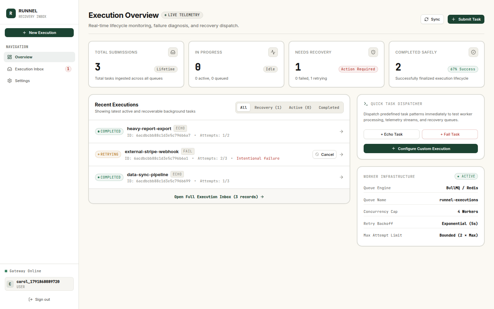
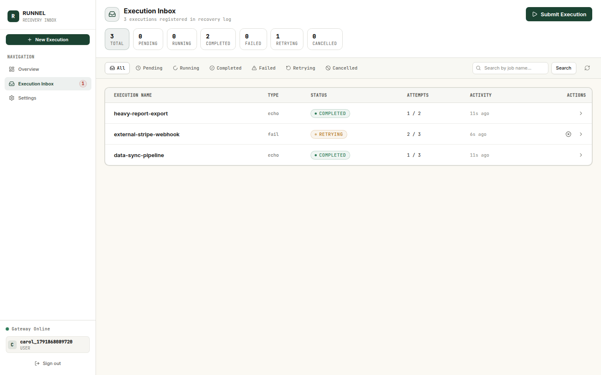
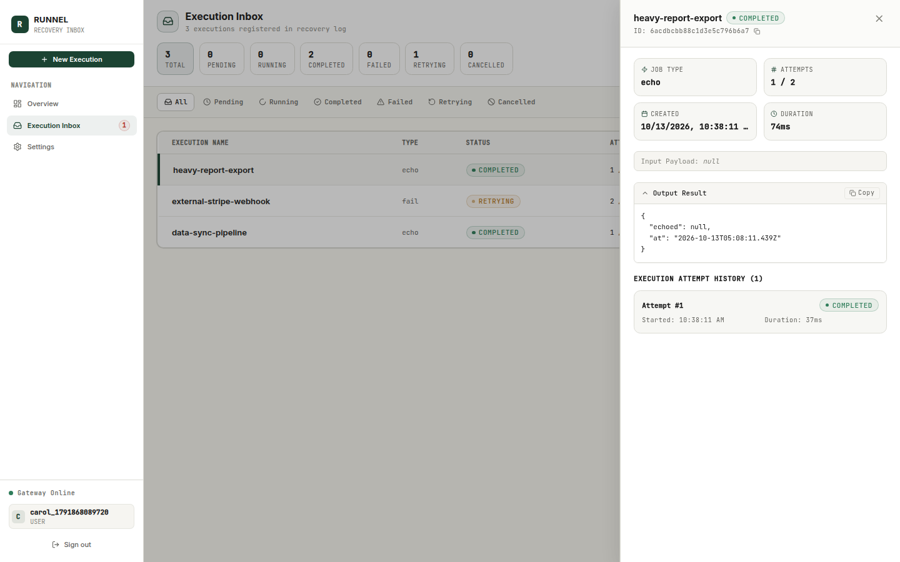
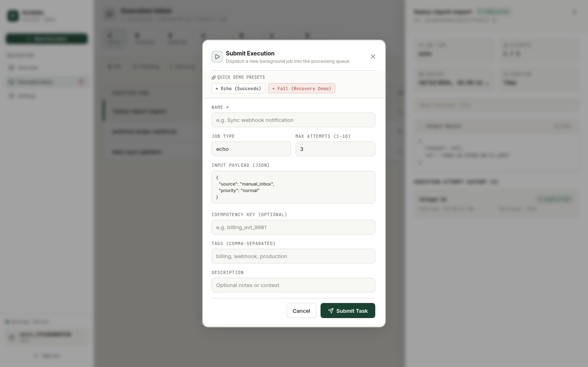
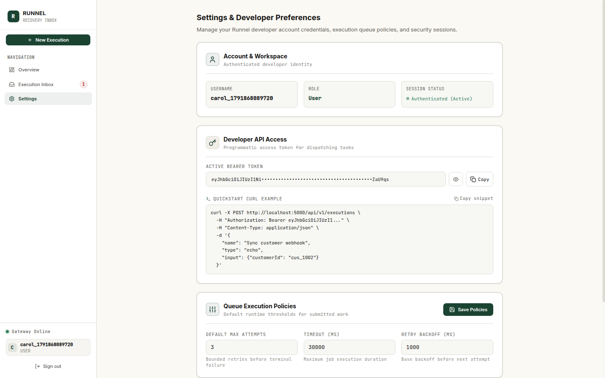
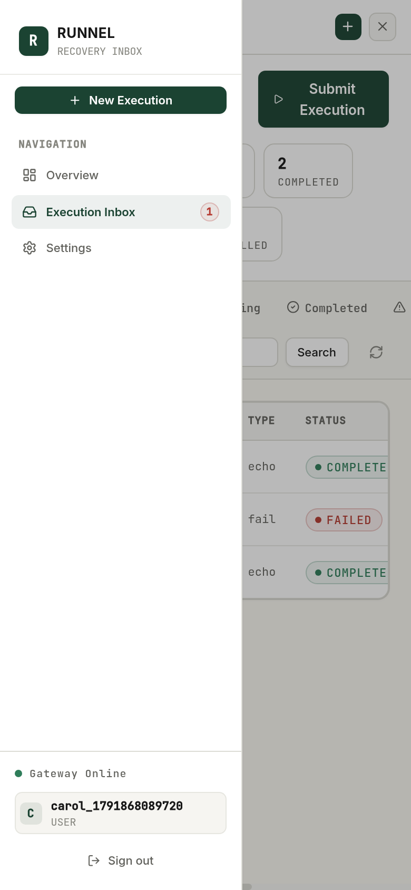

# Runnel

> **A recovery inbox for asynchronous work.**  
> Submit background tasks, track execution lifecycles, inspect attempt histories, understand failures, retry work safely, and maintain a reliable operational record.

---

## 1. Product Overview

In modern distributed systems, background tasks and asynchronous operations fail silently or vanish into opaque log streams. **Runnel** provides engineering teams with a dedicated, observable inbox to monitor, diagnose, and recover background work.

### Core Capabilities
- **Execution Inbox & Recovery Center:** Filter, search, and paginate through asynchronous background executions by status (`pending`, `running`, `completed`, `failed`, `retrying`, `cancelled`).
- **Atomic Attempt Lifecycles:** Track multiple attempts per execution with execution durations, structured error codes, stack traces, and attempt timestamps.
- **Safe, Bounded Retries:** Trigger manual and automatic retries bounded by configurable policy limits and idempotency keys to eliminate duplicate side effects.
- **Idempotency & Conflict Detection:** Per-user idempotency keys calculate deterministic payload hashes, rejecting payload collisions with `409 CONFLICT` and deduplicating retried requests.
- **Real-Time WebSocket Streaming:** Live status updates, attempt counts, and queue activity streamed instantly over authenticated Socket.IO rooms.
- **Developer-First API & Presets:** Dispatch executions directly from your CLI, CI/CD pipeline, or scripts with standardized bearer tokens and cURL examples.
- **Stitch Design Identity:** Warm ivory canvas (`#FBF9F3`), structural white surfaces (`#FFFFFF`), forest green primary accents (`#1B4332`), and restrained terracotta alerts (`#B63B32`).
- **Independent Viewport Scrolling:** Fixed desktop sidebar navigation with independently scrollable main execution log and responsive mobile navigation drawer.
- **Zero-Cruft Architecture:** Pure Runnel recovery inbox with all obsolete ecosystem simulation and ML services safely excised.

---

## 2. Architecture

Runnel is built on a high-throughput, horizontally scalable Node.js/BullMQ backend and a React 19 frontend.

```text
Browser (React 19 + Vite 7 + Tailwind CSS)
        │
        │   REST API (/api/v1)  ·  Socket.IO (Authenticated user rooms)
        ▼
Express API Gateway (Node.js, Port 5000)
        │
        ├── Authentication Module (JWT + bcrypt + Session Rotation)
        ├── Execution Module (Idempotency, State Transitions, Attempt History)
        ├── User & Policy Store
        │
        ├── MongoDB (Persistence)
        │       Executions, Attempts, Users, Operational Logs
        │
        ├── Redis (BullMQ Infrastructure)
        │       Queue: runnel-executions (Concurrency: 4)
        │       Rate Limiting & Token Revocation
        │
        └── BullMQ Execution Worker
                Lifecycle runner, retry bounds, attempt logging,
                error stack capture, and Socket.IO emission
```

### Layout Architecture
- **Desktop (>= 1024px):** Fixed-height viewport (`h-screen overflow-hidden`). The sidebar navigation remains anchored to the viewport at all times, with internal scrolling for overflow. The main content region (`<main className="flex-1 min-w-0 min-h-0 h-full overflow-y-auto">`) scrolls independently without page-level jitter.
- **Mobile (< 768px):** Sticky top bar with quick submission trigger and navigation drawer toggle. Fluid off-canvas slide-over drawer with backdrop overlay.

---

## 3. Technology Stack

| Layer | Technologies |
|---|---|
| **Frontend** | React 19, Vite 7, React Router 7, Tailwind CSS, Lucide Icons, Framer Motion, Socket.IO Client |
| **API Server** | Node.js, Express 4, Mongoose 7, Socket.IO 4, Zod, Winston |
| **Queue & Worker** | BullMQ 5, Redis 7 |
| **Database** | MongoDB 6+ (with automatic embedded memory fallback for frictionless dev) |
| **Testing** | Node.js native test runner (`node --test`), Supertest, MongoMemoryServer (Hermetic tests) |

---

## 4. Screenshots

| Overview Dashboard | Execution Inbox |
|---|---|
|  |  |

| Execution Detail & Attempts | Submit Task Modal |
|---|---|
|  |  |

| Developer Settings & Policies | Mobile Responsive Drawer (390px) |
|---|---|
|  |  |

---

## 5. Getting Started

### Prerequisites
- **Node.js** >= 18.0.0
- **Redis** running locally on `127.0.0.1:6379` (or via Docker)
- **MongoDB** running locally on `27017` *(optional: in dev mode, Runnel automatically boots an embedded in-memory MongoDB if external MongoDB is absent)*

### 1. Clone & Install Dependencies
```bash
git clone https://github.com/goravgumber/Runnel.git
cd Runnel

# Install backend dependencies
cd backend && npm install

# Install frontend dependencies
cd ../frontend && npm install
```

### 2. Configure Environment
```bash
# In backend/
cp .env.example .env

# In frontend/
cp .env.example .env
```

Default backend configuration (`backend/.env`):
```env
NODE_ENV=development
PORT=5000
MONGO_URI=mongodb://127.0.0.1:27017/runnel
REDIS_URL=redis://127.0.0.1:6379
JWT_SECRET=super-secret-runnel-key-at-least-32-chars
JWT_EXPIRES_IN=15m
JWT_REFRESH_EXPIRES_IN=7d
```

### 3. Launch Development Servers

**Start Backend (API + Workers):**
```bash
cd backend
npm run dev
# or: node server.js
```

**Start Frontend:**
```bash
cd frontend
npm run dev
```

Visit **`http://localhost:5173`** in your browser.

---

## 6. Docker Deployment

Deploy the entire production stack using Docker Compose:

```bash
docker compose up -d
```

Services started:
- `runnel_mongodb` (Port 27017)
- `runnel_redis` (Port 6380:6379)
- `runnel_backend` (Port 5000)
- `runnel_frontend` (Port 8080)
- `runnel_nginx` (Port 80)

---

## 7. API Reference

All protected endpoints require an `Authorization: Bearer <JWT_ACCESS_TOKEN>` header.

### Authentication
- `POST /api/v1/auth/signup` — Register a new account (`username`, `password`).
- `POST /api/v1/auth/login` — Sign in and receive `accessToken` & `refreshToken`.
- `POST /api/v1/auth/refresh` — Rotate refresh token for a new access token.
- `GET /api/v1/auth/validate` — Validate current access token.
- `GET /api/v1/auth/me` — Retrieve active user profile.
- `POST /api/v1/auth/logout` — Revoke active token.
- `POST /api/v1/auth/logout-all` — Invalidate all user sessions across devices.

### Executions
- `POST /api/v1/executions` — Submit a background execution job.
  ```json
  {
    "name": "Sync Stripe Webhook",
    "type": "echo",
    "payload": { "eventId": "evt_1002" },
    "maxAttempts": 3,
    "idempotencyKey": "webhook_evt_1002",
    "tags": ["billing", "stripe"]
  }
  ```
- `GET /api/v1/executions` — Paginated list with filters (`status`, `search`, `page`, `limit`).
- `GET /api/v1/executions/:id` — Full execution details, input/output, and attempt history.
- `POST /api/v1/executions/:id/retry` — Manually retry a failed or cancelled execution.
- `POST /api/v1/executions/:id/cancel` — Cancel a pending or running execution.
- `GET /api/v1/executions/stats` — Aggregated counts by status (`total`, `pending`, `running`, `completed`, `failed`, `retrying`, `cancelled`).

### User & Policy Settings
- `GET /api/v1/users/settings` — Get current user execution queue policies.
- `PATCH /api/v1/users/settings` — Update operational policies (`defaultMaxAttempts`, `defaultExecutionTimeoutMs`, `retryBackoffMs`).

---

## 8. Testing & Quality Gates

Runnel includes a 100% hermetic automated test suite requiring no manual database setup:

```bash
# Run all backend unit, integration, and lifecycle tests (48 tests)
cd backend
NODE_ENV=test npm test

# Run frontend production build check
cd ../frontend
npm run build
```

### Verified Test Matrix
- **Auth Suite (12 tests):** Validation, password hashing, JWT rotation, session restore, duplicate username protection, protected route enforcement.
- **Execution Lifecycle Suite (28 tests):** Submission validation, bounded retries, idempotency and payload conflict checks, concurrency safety, cancellation rules, enqueue failure handling.
- **Worker Suite (8 tests):** Handler registry, execution job lifecycles, error recording, attempt logging.

---

## 9. Architecture Decision Records (ADRs)

1. **ADR-001: Warm Ivory & Stitch Atelier OS Identity:** Adopted Stitch design tokens (`#FBF9F3` canvas, `#FFFFFF` surfaces, `#1B4332` forest green, `#B63B32` terracotta).
2. **ADR-002: Hermetic Test Setup:** Wrapped the backend test runner in `mongodb-memory-server` and test-mode rate-limit bypasses to eliminate flaky timer leaks and avoid external database dependencies.
3. **ADR-003: Safe Legacy Decommissioning & Zero-Cruft Consolidation:** Completely audited and removed obsolete ecosystem simulation models, ML services, and unreferenced routes, resulting in a singular, pristine Runnel codebase.
4. **ADR-004: Viewport Flex Shell with Independent Main Scrolling:** Established `h-screen overflow-hidden` flex shell with fixed anchored sidebar and independent `overflow-y-auto min-h-0` on `<main>`, eliminating full-page scrolling defects across desktop and mobile.

---

## 10. License

Distributed under the MIT License. See `LICENSE` for more information.
