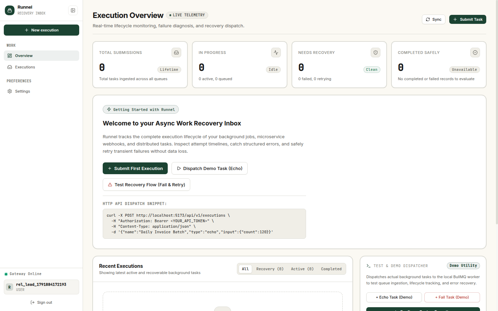
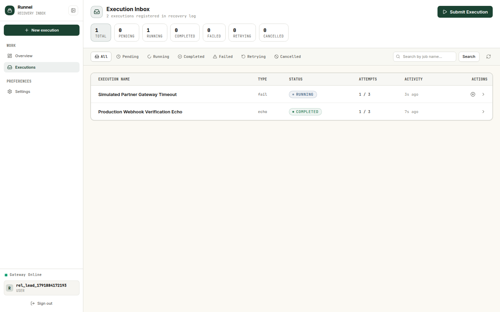
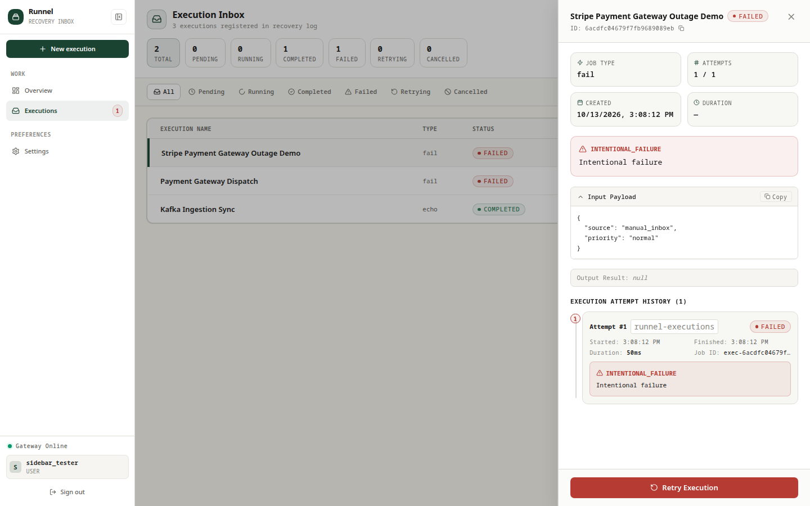
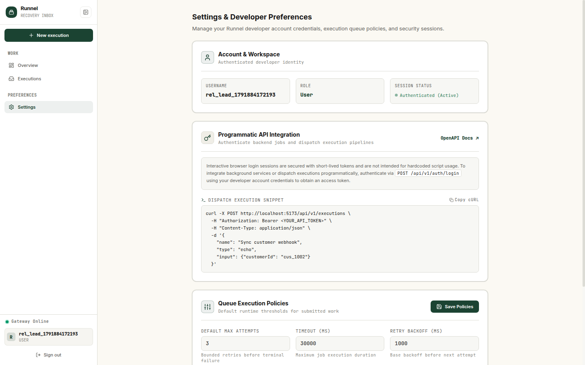
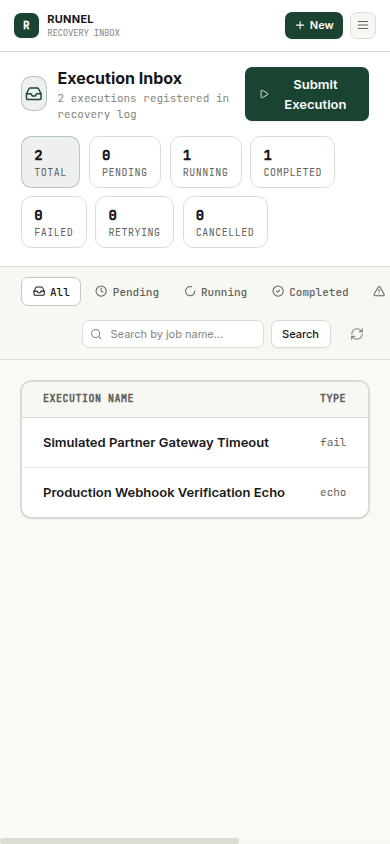

# Runnel

> **A recovery inbox for asynchronous work.**  
> Submit background tasks, track execution lifecycles, inspect attempt histories, understand failures, retry work safely, and maintain a reliable operational record.

---

## 1. Product Overview

In modern distributed systems, background tasks and asynchronous operations fail silently or vanish into opaque log streams. **Runnel** provides engineering teams with a dedicated, observable inbox to monitor, diagnose, and recover background work.

### Core Capabilities
- **Execution Inbox & Recovery Center:** Filter, search, and paginate through asynchronous background executions by status (`pending`, `running`, `completed`, `failed`, `retrying`, `cancelled`).
- **Atomic Attempt Lifecycles:** Track multiple attempts per execution with execution durations, structured error codes, stack traces, and attempt timestamps.
- **Safe, Bounded Retries:** Trigger manual and automatic retries bounded by configurable policy limits and idempotency keys to eliminate duplicate side effects.
- **Idempotency & Conflict Detection:** Per-user idempotency keys calculate deterministic payload hashes, rejecting payload collisions with `409 CONFLICT` and deduplicating retried requests.
- **Real-Time WebSocket Streaming:** Live status updates, attempt counts, and queue activity streamed instantly over authenticated Socket.IO rooms.
- **Developer-First API & Presets:** Dispatch executions directly from your CLI, CI/CD pipeline, or scripts with standardized bearer tokens and cURL examples.
- **Stitch Design Identity:** Warm ivory canvas (`#FBF9F3`), structural white surfaces (`#FFFFFF`), forest green primary accents (`#1B4332`), and restrained terracotta alerts (`#B63B32`).
- **Independent Viewport Scrolling:** Fixed desktop sidebar navigation with independently scrollable main execution log and responsive mobile navigation drawer.
- **Zero-Cruft Architecture:** Pure Runnel recovery inbox with all obsolete ecosystem simulation and ML services safely excised.

---

## 2. Architecture

Runnel is built on a high-throughput, horizontally scalable Node.js/BullMQ backend and a React 19 frontend.

```text
Browser (React 19 + Vite 7 + Tailwind CSS)
        │
        │   REST API (/api/v1)  ·  Socket.IO (Authenticated user rooms)
        ▼
Express API Gateway (Node.js, Port 5000)
        │
        ├── Authentication Module (JWT + bcrypt + Session Rotation)
        ├── Execution Module (Idempotency, State Transitions, Attempt History)
        ├── User & Policy Store
        │
        ├── MongoDB (Persistence)
        │       Executions, Attempts, Users, Operational Logs
        │
        ├── Redis (BullMQ Infrastructure)
        │       Queue: runnel-executions (Concurrency: 4)
        │       Rate Limiting & Token Revocation
        │
        └── BullMQ Execution Worker
                Lifecycle runner, retry bounds, attempt logging,
                error stack capture, and Socket.IO emission
```

### Layout Architecture
- **Desktop (>= 1024px):** Fixed-height viewport (`h-screen overflow-hidden`). The sidebar navigation remains anchored to the viewport at all times, with internal scrolling for overflow. The main content region (`<main className="flex-1 min-w-0 min-h-0 h-full overflow-y-auto">`) scrolls independently without page-level jitter.
- **Mobile (< 768px):** Sticky top bar with quick submission trigger and navigation drawer toggle. Fluid off-canvas slide-over drawer with backdrop overlay.

---

## 3. Technology Stack

| Layer | Technologies |
|---|---|
| **Frontend** | React 19, Vite 7, React Router 7, Tailwind CSS, Lucide Icons, Framer Motion, Socket.IO Client |
| **API Server** | Node.js, Express 4, Mongoose 7, Socket.IO 4, Zod, Winston |
| **Queue & Worker** | BullMQ 5, Redis 7 |
| **Database** | MongoDB 6+ (with automatic embedded memory fallback for frictionless dev) |
| **Testing** | Node.js native test runner (`node --test`), Supertest, MongoMemoryServer (Hermetic tests) |

---

## 4. Screenshots

| Sign In & Execution Lifecycle Preview | Overview Dashboard |
|---|---|
|  |  |

| Execution Inbox & Real Queues | Attempt Timeline & Error Diagnostics |
|---|---|
|  |  |

| Recovery Retry Confirmation Dialog | Developer Preferences & API Security |
|---|---|
|  |  |

| Mobile Responsive Viewport (390×844) |
|---|
|  |

---

## 5. Getting Started

### Prerequisites
- **Node.js** >= 18.0.0
- **Redis** running locally on `127.0.0.1:6379` (or via Docker)
- **MongoDB** running locally on `27017` *(optional: in dev mode, Runnel automatically boots an embedded in-memory MongoDB if external MongoDB is absent)*

### 1. Clone & Install Dependencies
```bash
git clone https://github.com/goravgumber/Runnel.git
cd Runnel

# Install backend dependencies
cd backend && npm install

# Install frontend dependencies
cd ../frontend && npm install
```

### 2. Configure Environment
```bash
# In backend/
cp .env.example .env

# In frontend/
cp .env.example .env
```

Default backend configuration (`backend/.env`):
```env
NODE_ENV=development
PORT=5000
MONGO_URI=mongodb://127.0.0.1:27017/runnel
REDIS_URL=redis://127.0.0.1:6379
JWT_SECRET=super-secret-runnel-key-at-least-32-chars
JWT_EXPIRES_IN=15m
JWT_REFRESH_EXPIRES_IN=7d
```

### 3. Launch Development Servers

**Start Backend (API + Workers):**
```bash
cd backend
npm run dev
# or: node server.js
```

**Start Frontend:**
```bash
cd frontend
npm run dev
```

Visit **`http://localhost:5173`** in your browser.

---

## 6. Docker Deployment

Deploy the entire production stack using Docker Compose:

```bash
docker compose up -d
```

Services started:
- `runnel_mongodb` (Port 27017)
- `runnel_redis` (Port 6380:6379)
- `runnel_backend` (Port 5000)
- `runnel_frontend` (Port 8080)
- `runnel_nginx` (Port 80)

---

## 7. API Reference

All protected endpoints require an `Authorization: Bearer <JWT_ACCESS_TOKEN>` header.

### Authentication
- `POST /api/v1/auth/signup` — Register a new account (`username`, `password`).
- `POST /api/v1/auth/login` — Sign in and receive `accessToken` & `refreshToken`.
- `POST /api/v1/auth/refresh` — Rotate refresh token for a new access token.
- `GET /api/v1/auth/validate` — Validate current access token.
- `GET /api/v1/auth/me` — Retrieve active user profile.
- `POST /api/v1/auth/logout` — Revoke active token.
- `POST /api/v1/auth/logout-all` — Invalidate all user sessions across devices.

### Executions
- `POST /api/v1/executions` — Submit a background execution job.
  ```json
  {
    "name": "Sync Stripe Webhook",
    "type": "echo",
    "payload": { "eventId": "evt_1002" },
    "maxAttempts": 3,
    "idempotencyKey": "webhook_evt_1002",
    "tags": ["billing", "stripe"]
  }
  ```
- `GET /api/v1/executions` — Paginated list with filters (`status`, `search`, `page`, `limit`).
- `GET /api/v1/executions/:id` — Full execution details, input/output, and attempt history.
- `POST /api/v1/executions/:id/retry` — Manually retry a failed or cancelled execution.
- `POST /api/v1/executions/:id/cancel` — Cancel a pending or running execution.
- `GET /api/v1/executions/stats` — Aggregated counts by status (`total`, `pending`, `running`, `completed`, `failed`, `retrying`, `cancelled`).

### User & Policy Settings
- `GET /api/v1/users/settings` — Get current user execution queue policies.
- `PATCH /api/v1/users/settings` — Update operational policies (`defaultMaxAttempts`, `defaultExecutionTimeoutMs`, `retryBackoffMs`).

---

---

## 8. Testing & Quality Gates

Runnel includes a 100% hermetic automated test suite requiring no manual database setup:

```bash
# Run all backend unit, integration, and security tests (122 tests across 24 suites)
cd backend
NODE_ENV=test npm test

# Run frontend code quality lint
cd ../frontend
npm run lint

# Run frontend production bundle compilation
npm run build
```

### Verified Test Matrix
- **Auth Suite:** Validation, password hashing, JWT rotation, session restore, duplicate username protection, protected route enforcement.
- **Execution Lifecycle Suite:** Submission validation, bounded retries, idempotency and payload conflict checks, concurrency safety, cancellation rules, enqueue failure handling.
- **Worker Suite:** Handler registry, execution job lifecycles, error recording, attempt logging.
- **Webhook Security Suite (46 Tests):** Canonical URL parsing, non-public IP ranges (IPv4/IPv6 private, loopback, link-local, multicast, carrier-grade NAT), cloud metadata endpoints (169.254.169.254, fd00:ec2::254, metadata.google.internal), DNS-rebinding immunity via pinned socket lookup, redirect validation, header sanitization, credential redaction, and stream bounding.
- **Reliable Stuck-Execution Recovery Suite (10 Tests):** Automated reconciliation pass, active BullMQ job preservation, delayed backoff retry preservation, worker interruption sync, concurrent race-condition safety, distributed locking across replicas, retry-limit exhaustion, database outage immunity, non-retryable execution flagging, and attempt history preservation.
- **Envelope & Utility Suite:** Role-based access control, standardized API envelopes, health readiness checks.

---

## 9. Backup, Disaster Recovery & Operational Procedures

Runnel state resides across MongoDB (primary state store) and Redis (ephemeral BullMQ queue data).

### MongoDB Backup
To capture a point-in-time snapshot of user executions, attempts, and accounts:
```bash
# Create compressed archive snapshot
mongodump --uri="mongodb://localhost:27017/runnel" --archive=runnel_backup_$(date +%Y%m%d_%H%M%S).gz --gzip
```

### MongoDB Restoration
To restore from a backup snapshot:
```bash
# Restore collections idempotently without dropping unrelated databases
mongorestore --uri="mongodb://localhost:27017/runnel" --nsInclude="runnel.*" --archive=runnel_backup_20261013_120000.gz --gzip
```

### Automated Stuck-Execution Recovery Service
Runnel features an automated, bounded, concurrency-safe reconciliation engine (`backend/services/executionRecoveryService.js`) that periodically detects executions abandoned due to worker container interruption, power failure, or ungraceful process crashes.

#### 1. Configuration (`.env`)
```bash
RECOVERY_ENABLED=true                # Enable/disable periodic background recovery
RECOVERY_INTERVAL_MS=60000          # Interval between reconciliation ticks (default: 60s)
RECOVERY_STALE_THRESHOLD_MS=300000  # Threshold before running job is considered stale (default: 5m)
RECOVERY_LOCK_TTL_MS=30000          # Redis distributed leader lock TTL (default: 30s)
RECOVERY_BATCH_SIZE=50              # Maximum candidates examined per tick (default: 50)
```

#### 2. Recovery Semantics & Invariants
- **BullMQ Queue Inspection:** Before mutating any candidate in MongoDB, the engine inspects the underlying BullMQ job in Redis.
  - If the job is `active` (lock held by active worker) or `delayed` (scheduled or backoff retry), it is strictly preserved.
  - If the job is `waiting` (interrupted worker), MongoDB is synchronized to `retrying` with code `WORKER_INTERRUPTED`.
  - If the job is `completed` or `failed` in BullMQ while MongoDB remained `running`, MongoDB is updated to mirror final state.
  - If the job is missing from Redis and retry budget is unexhausted, it is safely re-enqueued; if exhausted, marked `failed` with `RECOVERY_RETRIES_EXHAUSTED`.
- **Atomic Concurrency Control:** All state transitions use atomic MongoDB preconditions (`{ _id, status: "running", updatedAt }`). Multiple concurrent worker instances cannot recover or re-enqueue the same execution twice.
- **Distributed Leader Lock:** Replicas coordinate using Redis `SET runnel:locks:stuck-recovery <id> PX <ttl> NX` so only one instance reconciles at a time.
- **Infrastructure Outage Immunity:** If MongoDB or Redis is disconnected, reconciliation aborts cleanly without misclassifying jobs as abandoned.
- **Attempt History Preservation:** Dangling running attempts are closed with `status: "failed"`, audit reason `WORKER_INTERRUPTED`, and elapsed duration; prior attempt records are never deleted or modified.
- **Genuine Operational Metrics:** Real-time metrics (`candidatesExamined`, `executionsRecovered`, `executionsRequeued`, `executionsFailed`, `skippedActive`, `skippedDelayed`, `reconciliationErrors`) are exposed via `/health` under `services.recovery`.

#### 3. Manual Intervention Query (Fallback)
If manual inspection or reconciliation is needed:
```javascript
// Query executions stalled in 'running' state longer than timeout threshold
const STUCK_THRESHOLD_MS = 5 * 60 * 1000;
const stuckExecutions = await Execution.find({
  status: "running",
  updatedAt: { $lt: new Date(Date.now() - STUCK_THRESHOLD_MS) }
});
```
Operators can trigger manual retries directly from the UI or via `POST /api/v1/executions/:id/retry`.

### Redis Persistence & Recovery
Redis stores active BullMQ queue locks and delayed jobs. For production durability:
- Enable Append-Only File (`appendonly yes` with `appendfsync everysec`) in `redis.conf`.
- In the event of a total Redis restart, in-flight jobs in status `pending` or `retrying` can be reconciled against MongoDB records or retried through the Recovery Inbox.

---

## 10. Security & Webhook Destination Policy

Runnel treats security vulnerabilities with utmost seriousness.

- **Webhook SSRF Protection:** In production environments, webhooks cannot target non-public IP destinations (RFC 1918 private subnets, loopback addresses, link-local cloud metadata endpoints). All DNS addresses are pre-resolved and pinned to the physical socket to prevent DNS rebinding attacks.
- **Redirect Boundaries:** Webhooks follow a maximum of 3 redirects. Every redirect hop is independently validated against the destination policy; redirects attempting to pivot to private or cloud metadata IPs are rejected with `SSRF_BLOCKED`.
- **Sensitive Header Redaction:** Authorization headers, tokens, cookies, and secret keys in webhook responses are automatically redacted before attempt history is persisted.
- **Session Hardening:** Interactive session JWTs are separated from machine-to-machine integrations. Never reuse session tokens as permanent API keys.
- **Secret Redaction:** Production health telemetry sanitizes hostnames, memory addresses, and system internals.
- **Vulnerability Reporting:** Email security details directly to `security@runnel.dev` or file a private GitHub Security Advisory.

---

## 11. Known Limitations & Roadmap

- **Delivery Semantics:** Runnel provides *at-least-once* execution semantics for background tasks. Downstream handlers should implement idempotent side effects where duplicate execution is unacceptable.
- **Dead Letter Queue (DLQ):** Failed jobs that exhaust their manual attempt limit (`maxAttempts * 2`) remain permanently in status `failed`. An automated dead-letter routing policy is planned for future milestones.
- **Single-Node Queue Dispatch:** The default configuration runs with concurrency 4 on a single BullMQ worker instance. Horizontal multi-worker scaling requires configuring clustered Redis infrastructure.

---

## 12. Contributing

We welcome contributions from the community!
1. Fork the repository and create your branch from `main`.
2. Ensure all tests (`npm test` in `backend/`) and linters (`npm run lint` in `frontend/`) pass.
3. Verify that your changes maintain the Stitch design tokens and do not expose sensitive credentials.
4. Submit a Pull Request with a clear description of the problem and test coverage.

---

## 13. License

Distributed under the MIT License. See `LICENSE` for more information.
