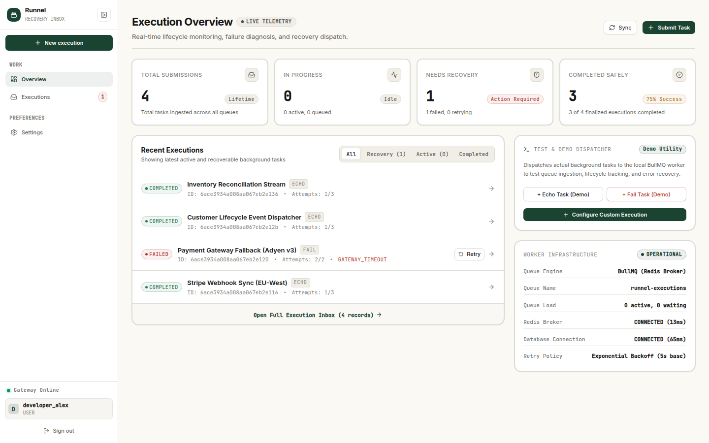
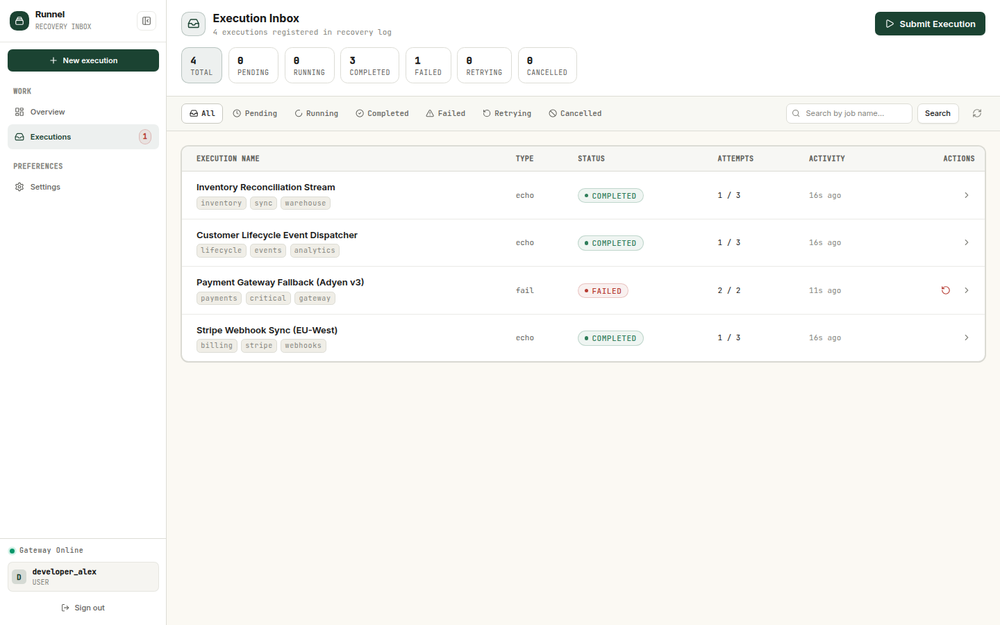
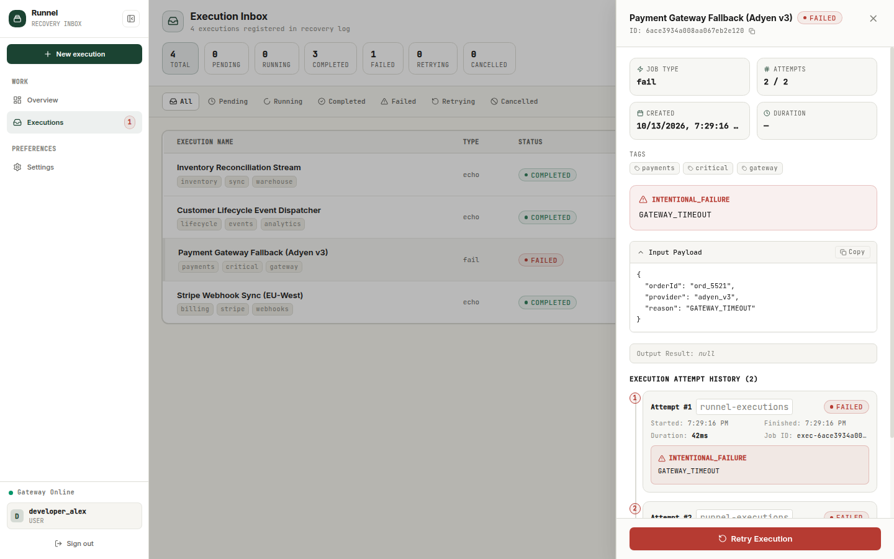
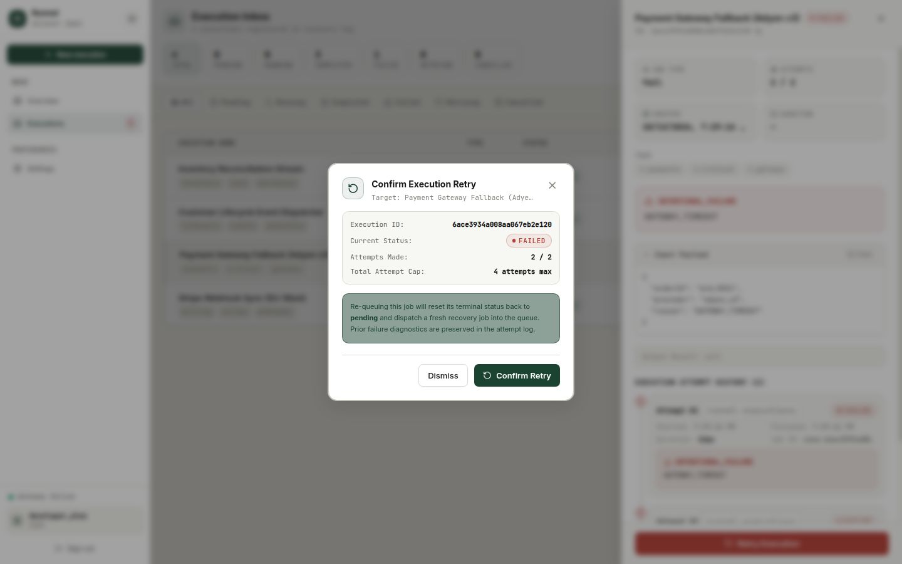
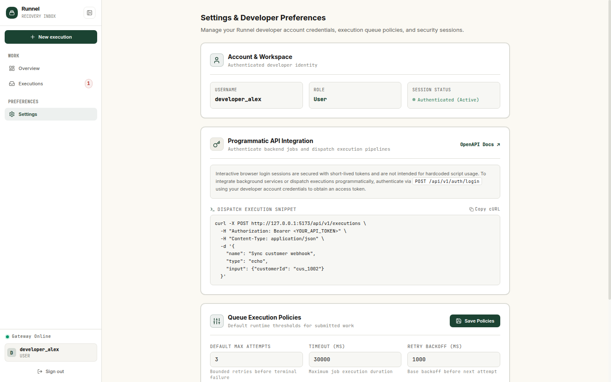
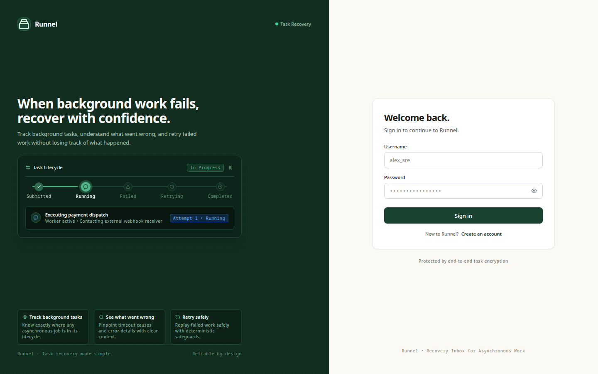
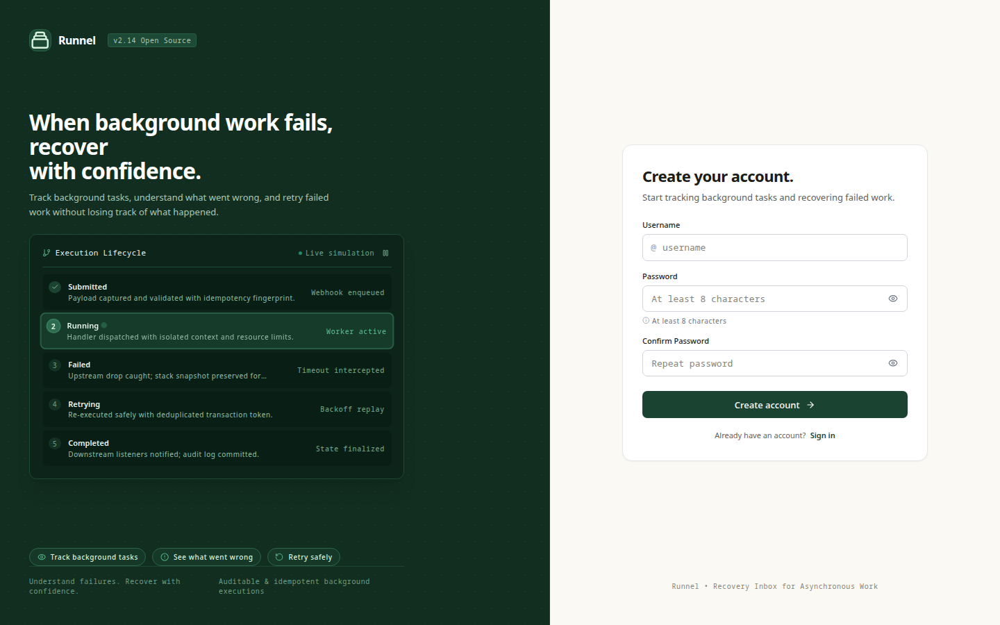
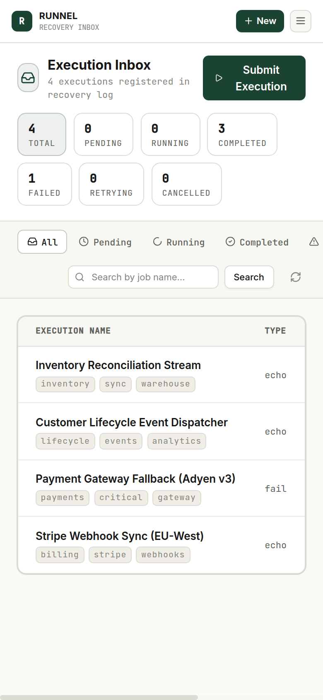
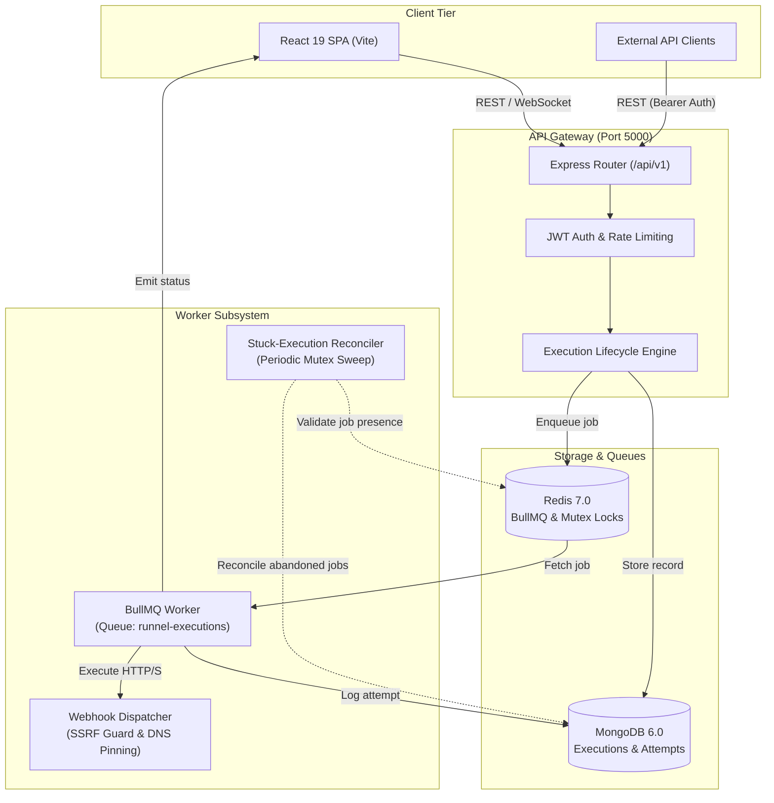

# Runnel

> **A recovery inbox for asynchronous work.**  
> Submit background tasks and webhooks, inspect execution lifecycles, diagnose attempt errors with structured stack traces, retry work safely with bounded idempotency, and automatically reconcile stuck tasks after worker disruptions.

[](https://github.com/goravgumber/Runnel/actions/workflows/ci.yml)
[](LICENSE)
[](https://nodejs.org/)
[](https://react.dev/)

---

## Product Showcase

### Overview Dashboard & Execution Metrics


---

### Core Product Experience

| Execution Inbox & Status Filters | Attempt History & Diagnostics Drawer |
|:---:|:---:|
|  |  |
| *Real-time inbox tracking pending, running, completed, and failed executions* | *Deep attempt timeline showing worker metadata, error codes, and traces* |

| Safe Recovery Retry Modal | Developer Queue & Operational Settings |
|:---:|:---:|
|  |  |
| *Confirmation dialog enforcing bounded retry budgets (`maxAttempts * 2`)* | *Configurable retry backoffs, timeouts, and quota rules* |

---

### Authentication & Responsive Experience

| Developer Sign In | Account Registration | Mobile Inbox View (390×844) |
|:---:|:---:|:---:|
|  |  |  |
| *JWT dual-token session management* | *Fast registration with role authorization* | *Responsive mobile drawer navigation* |

---

## Why Runnel Exists

In distributed backend architectures, background tasks, asynchronous event pipelines, and outbound webhooks routinely fail silently or get buried inside hundreds of megabytes of raw application logs. When a webhook times out, a worker drops offline during deployment, or a third-party API returns an unexpected error, engineers often lack:

1. **Immediate Visibility**: An observable inbox showing the real-time status of asynchronous jobs.
2. **Attempt History**: Granular, chronological attempt logs recording exact runtimes, response codes, and sanitized headers.
3. **Safe Manual Retries**: Guardrails that prevent double-enqueuing, accidental race conditions, or unbounded retries.
4. **Automated Recovery**: Self-healing reconciliation when background worker processes crash mid-execution.

**Runnel** solves this by providing a unified **recovery inbox**: a dedicated interface and robust API to submit asynchronous executions, observe progress in real time, inspect exact failure reasons, retry work safely, and maintain an immutable operational audit log.

---

## Core Capabilities

- **Observable Execution Inbox**: Filter, search, and paginate through asynchronous executions by status (`pending`, `running`, `completed`, `failed`, `retrying`, `cancelled`).
- **Atomic Attempt Lifecycles**: Every execution captures an array of chronological `ExecutionAttempt` records with wall-clock execution duration, BullMQ worker metadata, error classifications, and stack traces.
- **Safe, Bounded Retries**: Trigger manual retries bounded by configurable policy limits (`maxAttempts * 2`). Concurrency-safe atomic transitions prevent double-enqueues.
- **Idempotency & Collision Protection**: Per-user `idempotencyKey` values compute canonical SHA-256 payload hashes. Matching submissions return existing records; altered payloads reject with `409 Conflict`.
- **Outbound Webhook Dispatcher with SSRF Boundaries**: Native HTTP/HTTPS client featuring RFC-compliant IP address filtering (`ipaddr.js`), cloud metadata blocking (AWS, Azure, GCP), DNS pinning to eliminate TOCTOU rebinding, manual redirect validation (max 3 hops), header sanitization, and 1 MB response body buffering.
- **Automated Stuck-Execution Recovery**: Self-healing reconciliation engine that runs periodically to detect executions abandoned by crashed worker processes, validates live queue state, and safely recovers or fails jobs using a Redis-backed distributed mutex lock.
- **Real-Time Live Streaming**: Push updates over authenticated Socket.IO rooms for status changes and attempt completions without aggressive polling.
- **Strict Tenant Isolation**: Per-user data partitioning ensures executions, attempts, and stats are inaccessible across accounts.

---

## How It Works



*Note: In the default deployment topology, the Express API Gateway, BullMQ Worker, and Stuck-Execution Recovery Service run within the backend Node.js process for lightweight simplicity, while communicating with MongoDB and Redis over private connections.*

---

## Technology Stack

| Layer | Technologies |
|:---|:---|
| **Frontend** | React 19, Vite 7, React Router 7, Tailwind CSS, Lucide Icons, Framer Motion, Socket.IO Client |
| **API Server** | Node.js (v22), Express 4, Mongoose 7, Socket.IO 4, Zod, Winston |
| **Queue & Worker** | BullMQ 5, Redis 7 (with distributed mutex locking via `ioredis`) |
| **Database** | MongoDB 6.0+ (with automatic embedded memory fallback for frictionless dev) |
| **Reverse Proxy** | Nginx (TLS 1.2/1.3 termination, HSTS, CSP, and WebSocket upgrades) |
| **Testing** | Node.js native test runner (`node --test`), Supertest, MongoMemoryServer (125 tests, 25 suites) |
| **CI / DevOps** | GitHub Actions, Docker, Docker Compose |

---

## Quick Start

### Prerequisites
- **Node.js** `>= 18.0.0` (v22 recommended)
- **Redis** running on `127.0.0.1:6379` (or via Docker)
- **MongoDB** running on `27017` *(optional: in development, Runnel automatically boots an embedded in-memory MongoDB instance if no local MongoDB is detected)*

### 1. Local Development Setup
```bash
# Clone the repository
git clone https://github.com/goravgumber/Runnel.git
cd Runnel

# Copy environment templates
cp .env.example .env
cp backend/.env.example backend/.env
cp frontend/.env.example frontend/.env

# Install dependencies using lockfiles
cd backend && npm ci
cd ../frontend && npm ci

# Seed development users (admin / Admin123!, testuser / User123!)
cd ../backend && node scripts/seed.js
```

### 2. Start Development Servers
**Terminal 1 — Backend API & Worker:**
```bash
cd backend
npm run dev
# Starts on http://localhost:5000
```

**Terminal 2 — Frontend Console:**
```bash
cd frontend
npm run dev
# Starts on http://localhost:5173
```
Visit **`http://localhost:5173`** to access the web application.

---

### 3. Docker Compose Deployment

**Local Staging (Complete Container Stack):**
```bash
docker compose up -d
```
Access the application on `http://localhost:8080` (or `http://localhost`).

**Production Deployment (with TLS & Restricted Networks):**
```bash
docker compose -f docker-compose.prod.yml --env-file .env.production up -d --build
```
For complete production runbooks, see [docs/deployment.md](docs/deployment.md).

---

## Project Structure

```text
Runnel/
├── .github/
│   └── workflows/
│       └── ci.yml               # Authoritative CI pipeline (check, test, lint, build, docker)
├── assets/
│   └── screenshots/             # Authentic product screenshots and visual assets
├── backend/
│   ├── config/                  # Environment schemas (Zod), Winston logger, Redis client
│   ├── controllers/             # Route controllers (auth, executions, admin, queues)
│   ├── middleware/              # Auth, AppError, rate-limiter, request logger, tracing
│   ├── models/                  # Mongoose models: User, Execution, ExecutionAttempt
│   ├── routes/                  # Versioned API routes (/api/v1)
│   ├── scripts/
│   │   ├── migrations/          # Idempotent database migrations (001, 002)
│   │   └── seed.js              # Development user fixture script
│   ├── services/                # Auth service, stuck-execution recovery service
│   ├── tests/                   # Native test suites (auth, executions, workers, security)
│   ├── utils/                   # Webhook client (SSRF guard), response formatter, cache
│   └── workers/                 # BullMQ execution worker & task handler registry
├── deployment/
│   └── nginx.conf               # Production Nginx reverse proxy configuration
├── docs/
│   ├── api.md                   # Comprehensive REST API reference
│   ├── architecture.md          # Platform architecture and operational modules
│   ├── deployment.md            # Production deployment topologies and runbooks
│   ├── development.md           # Local setup, environment contracts, and developer tips
│   └── testing.md               # Test matrix, SSRF validation, and recovery tests
├── frontend/
│   ├── src/
│   │   ├── components/          # UI primitives: Button, Modal, Drawer, Table, StatusBadge
│   │   ├── context/             # AuthContext (JWT management & session restore)
│   │   ├── pages/               # Dashboard, ExecutionInbox, Login, Signup, Settings
│   │   └── services/            # Axios/Fetch API clients & WebSocket connection
│   └── vite.config.js           # Vite 7 build configuration and API proxy
├── docker-compose.yml           # Default development container orchestration
├── docker-compose.dev.yml       # Minimal backing-services Compose configuration
├── docker-compose.prod.yml      # Hardened production Compose configuration
├── CONTRIBUTING.md              # Contributor guidelines and standards
├── SECURITY.md                  # Security policies and vulnerability disclosure
└── LICENSE                      # MIT License
```

---

## Verification & Quality Gates

Runnel maintains an automated test matrix with 100% hermetic test execution:

```bash
# Backend syntax check
cd backend && npm run check

# Full backend test suite (125 tests across 25 suites)
cd backend && npm test

# Frontend ESLint check
cd ../frontend && npm run lint

# Frontend production compilation
cd ../frontend && npm run build
```

For complete details on test coverage and security boundary tests, see [docs/testing.md](docs/testing.md).

---

## Documentation Index

- **[System Architecture](docs/architecture.md)** — Architectural design, execution state machine, and SSRF boundary.
- **[API Reference](docs/api.md)** — Complete endpoint definitions, request/response formats, and status codes.
- **[Local Development Guide](docs/development.md)** — Step-by-step setup, configuration reference, and development workflows.
- **[Production Deployment Guide](docs/deployment.md)** — VPS setup, Docker Compose production, TLS termination, and backup runbooks.
- **[Testing & Quality Assurance Guide](docs/testing.md)** — Hermetic test details, webhook SSRF test matrix, and recovery verification.
- **[Security Policy](SECURITY.md)** — Vulnerability reporting guidelines and architectural defenses.
- **[Contributing Guidelines](CONTRIBUTING.md)** — Code of conduct and pull request standards.

---

## License

This project is licensed under the [MIT License](LICENSE).
