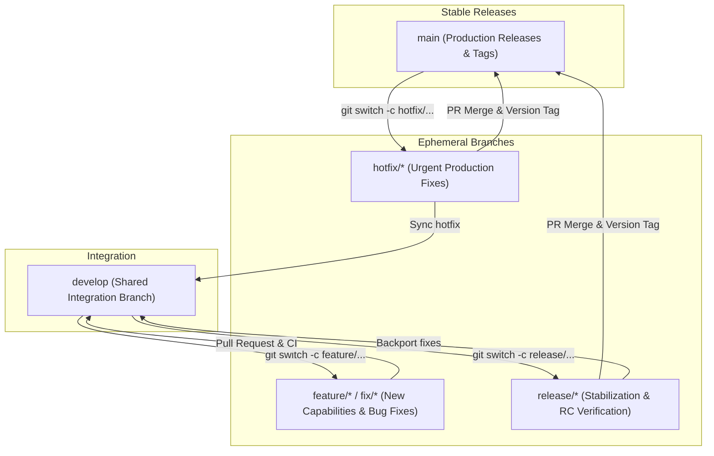

# Contributing to Runnel

Thank you for contributing to **Runnel — Recovery Inbox for Asynchronous Work**.

Runnel is designed to give engineering teams high-confidence observability, safe retry lifecycles, and resilient recovery for background jobs and webhook deliveries. To ensure production stability, security, and traceability, all contributors follow the Git branching strategy and pull request guidelines below.

---

## 1. Branching Strategy

Runnel utilizes an adapted Git-Flow branching model designed for continuous integration, predictable release tagging, and rapid emergency hotfixes.



### Core Branches

#### `main`
- **Purpose**: Stable, production-ready, release-certified codebase.
- **Rules**:
  - Only merge verified, tested release candidates or audited hotfixes into `main`.
  - Every release on `main` must be identifiable through a semantic version tag (e.g., `v1.0.0`).
  - **No direct commits or feature development on `main`.**
  - **Never force-push to `main`.**
  - Production hotfixes merged into `main` must always be backported into `develop`.

#### `develop`
- **Purpose**: Shared integration branch for active development.
- **Rules**:
  - New features and normal bug fixes target `develop`.
  - Only merge changes after code review and successful CI execution (`Runnel CI`).
  - Keep `develop` in a passing, deployable state at all times.
  - Contributors branch off the latest `develop`.
  - Pull requests for features and fixes target `develop`.

### Supporting Branches

| Branch Type | Naming Convention | Base Branch | Merge Target | Lifecycle |
| :--- | :--- | :--- | :--- | :--- |
| **Feature** | `feature/<short-description>` | `develop` | `develop` | Deleted after PR merge |
| **Bug Fix** | `fix/<short-description>` | `develop` | `develop` | Deleted after PR merge |
| **Hotfix** | `hotfix/<short-description>` | `main` | `main` & `develop` | Deleted after release tag |
| **Release** | `release/<version>` | `develop` | `main` & `develop` | Deleted after release tag |

---

## 2. Contributor Workflow

### Step 1: Sync Integration Branch
Always begin from the latest `develop` branch:
```bash
git switch develop
git pull origin develop
```

### Step 2: Create a Feature or Fix Branch
```bash
git switch -c feature/execution-batch-purge
# or for bug fixes:
git switch -c fix/webhook-timeout-dns-pinning
```

### Step 3: Make Changes & Verify Locally
Implement changes and verify that all linting, test suites, and builds pass:
```bash
# Backend syntax & test suites (125 tests)
cd backend
npm run check
npm test

# Frontend lint & production build
cd ../frontend
npm run lint
npm run build

# Docker Compose configuration check
cd ..
JWT_SECRET="ci_sample_production_jwt_secret_32_chars_min" docker compose config --quiet
```

### Step 4: Commit Changes
Commit with structured, imperative commit messages following Conventional Commits (`feat:`, `fix:`, `chore:`, `perf:`, `docs:`, `test:`):
```bash
git add backend/controllers/executionController.js backend/tests/executions.test.js
git commit -m "feat(executions): support batch purge with tenant boundary enforcement"
```

### Step 5: Publish Branch & Open Pull Request
Push your feature branch to GitHub:
```bash
git push -u origin feature/execution-batch-purge
```
Open a Pull Request on GitHub with the target branch set to **`develop`** (never directly to `main`).

---

## 3. Release Workflow

When `develop` contains a sufficient set of features and fixes for a release milestone:

1. **Verify CI & Automated Checks**: Ensure all continuous integration suites on `develop` pass cleanly.
2. **Create Release Branch**:
   ```bash
   git switch develop
   git pull origin develop
   git switch -c release/v1.0.0
   ```
3. **Stabilization & Bumping**: Perform final smoke testing, staging verification (`scripts/staging_readiness_audit.js`), and version manifest updates if necessary.
4. **Merge into `main`**:
   Submit a reviewed Pull Request from `release/v1.0.0` into `main`. Once approved and CI passes, merge it.
5. **Tag the Release**:
   ```bash
   git switch main
   git pull origin main
   git tag -a v1.0.0 -m "Release v1.0.0 — Recovery inbox for asynchronous work"
   git push origin v1.0.0
   ```
6. **Propagate Back into `develop`**:
   Merge `release/v1.0.0` back into `develop` (or merge `main` into `develop`) so any release-only adjustments remain synchronized. Delete the ephemeral `release/v1.0.0` branch.

---

## 4. Production Hotfix Workflow

When a critical bug is discovered in production:

1. **Branch from `main`**:
   ```bash
   git switch main
   git pull origin main
   git switch -c hotfix/ssrf-dns-rebinding-guard
   ```
2. **Implement & Test Fix**: Add regression tests proving the bug and verifying the remediation.
   ```bash
   cd backend && npm test
   ```
3. **Merge into `main` via PR**:
   Open an expedited Pull Request targeting `main`. Once reviewed and green, merge.
4. **Tag the Patch Release**:
   ```bash
   git switch main
   git pull origin main
   git tag -a v1.0.1 -m "Patch v1.0.1: Fix SSRF DNS rebinding edge case"
   git push origin v1.0.1
   ```
5. **Backport to `develop`**:
   Ensure `develop` immediately receives the fix:
   ```bash
   git switch develop
   git pull origin develop
   git merge --no-ff hotfix/ssrf-dns-rebinding-guard
   git push origin develop
   ```
6. **Delete Hotfix Branch**: Remove the local and remote `hotfix/*` branch.

---

## 5. GitHub Configuration & Branch Protection Recommendations

### Default Branch Recommendation
- **`main`**: Recommended to remain the default branch for repository visitors, cloning users, and package consumers seeking certified, stable releases.
- **Contribution Policy**: Contributors and automated PR templates must explicitly designate `develop` as the base branch for contributions. *(If the team prefers all new PRs to default to `develop` without manual branch selection, changing the GitHub default branch to `develop` can be decided as a team administration action).*

### Recommended Branch Protection Rules

#### Protection for `main`
- **Require a pull request before merging** (minimum 1 peer review).
- **Require status checks to pass before merging**:
  - `Runnel CI / Backend Tests & Syntax`
  - `Runnel CI / Frontend Lint & Build`
  - `Runnel CI / Docker Configuration Validation`
- **Require branches to be up to date before merging**.
- **Require linear history or standard merge commits** (no rebase fast-forward that strips audit trail).
- **Do not allow force pushes**.
- **Do not allow branch deletion**.

#### Protection for `develop`
- **Require a pull request before merging**.
- **Require status checks to pass before merging** (same CI matrix as `main`).
- **Do not allow force pushes**.
- **Do not allow branch deletion**.

---

## 6. Architectural Rules & Standards

When authoring code for Runnel, adhere strictly to these engineering tenets:

1. **Zero Mock Data in Production:** All dashboard metrics, execution statuses, attempt counts, and timeline items must be backed by live database records and WebSocket events.
2. **Stitch Design System Tokens:** Preserve the canonical dark/neutral aesthetic palette:
   - Ivory Canvas: `#FBF9F3`
   - Dark Moss / Forest Green: `#1B4332`
   - Amber Attention: `#B6731B`
   - Crimson Alert: `#B63B32`
   - Charcoal Neutral: `#1C1917`
3. **Tenant Isolation:** Every execution modification must respect user boundaries (`userId`) and state pre-conditions. Never allow cross-user access or non-atomic state mutations.
4. **Outbound Request Hardening:** Any changes to the webhook dispatcher or worker handlers must strictly respect SSRF destination policies (`validateDestination`), DNS pinning, redirect limits, and response byte bounding.
5. **No Synthetic Production Handlers:** Demo handlers (`echo`, `fail`) are strictly for local testing and must remain disabled in production (`ENABLE_DEMO_HANDLERS=false`).
